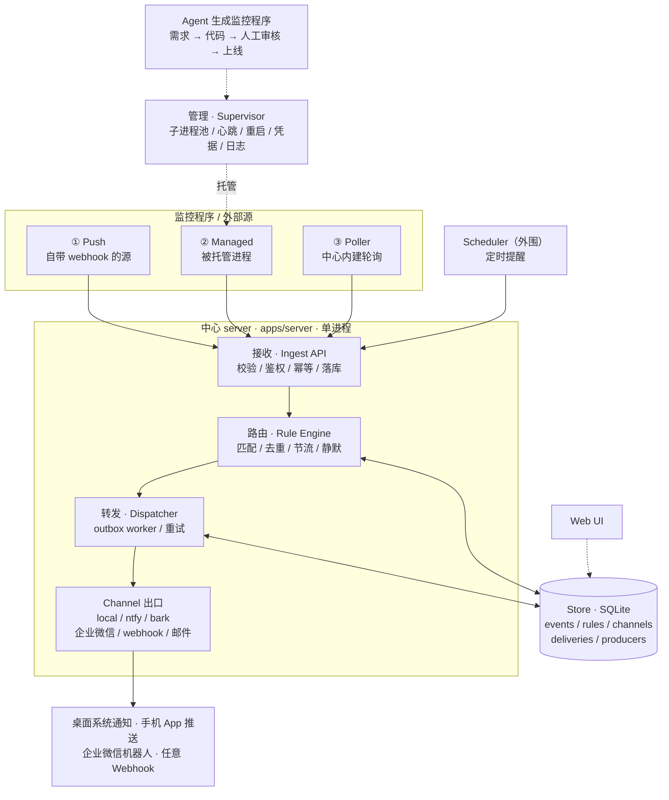
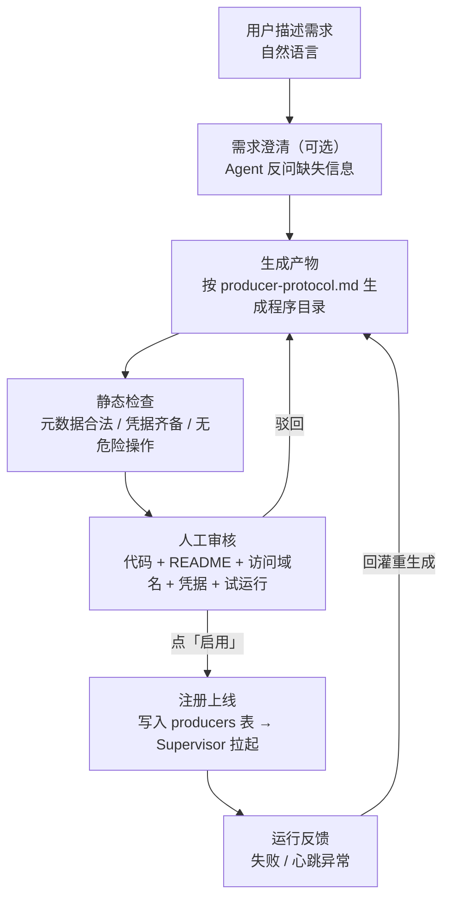

# 通用提醒系统 技术方案（工作名 `notify-hub`）

> **本文档是项目基准。** 后续所有开发以此为准；实现中遇到本文未覆盖的分支，
> 先回到本文更新，再继续实现，不得悄悄偏离。
>
> 工作名 `notify-hub` 只是占位，随时可改。

---

## 0. 已确认的需求前提

| 维度 | 结论 |
|---|---|
| 核心流程 | **管理监控程序 → 按固定格式接收事件 → 路由 → 转发到任意 channel → 各端弹通知** |
| 外围功能 | 时间管理 / 待办 / 周期任务：**复用同一条转发通道**，属额外开发，优先度低 |
| 定位 | 先自用，后通用 |
| 语言/栈 | TS / Node（与 mc-agent 同栈，复用经验与工具链） |
| 监控程序接入 | 三种都要：被动 webhook 推入、被托管的监控程序、中心内建轮询 |
| 监控程序托管 | 既支持中心托管调度，也支持程序自部署只推事件 |
| **Agent 写监控程序** | **核心能力，第一期就要**；生成后**人工审核**才上线 |
| 提醒出口 | 桌面系统通知、手机 App 推送、企业微信官方机器人、任意 Webhook |
| 可靠性 | 必须持久化 + 重试 + 离线补发（不允许静默丢消息） |
| 接收格式 | **简洁**，不留冗余；但信息要够"通知"——可以只是一句话，也可以带完整正文 |
| 交互 | 一开始就要 Web UI |
| 登录态监控运行位置 | 混合：登录态相关跑内网常驻机，其余可跑服务器 |
| 部署资源 | 有内网常驻电脑 + 有公网 VPS（暂无域名） |
| 时间预算 | 每周 10h 以上 |
| 首个真实验收场景 | GitHub PR 回复/更新 → 手机收到提醒 |

---

## 1. 目标与成功标准

### 1.1 总目标

做一条**通用的事件→提醒管道**，把四件事做透：

1. **管理**：统一托管一堆实时监控程序（写监控程序、启停、看状态、看日志、重启、注入凭据）。
2. **接收**：任何监控程序或外部源，按**同一套简洁格式**把事件推给中心。
3. **转发**：按规则把事件路由、去重、节流后，投递到任意目标。
4. **弹通知**：电脑弹系统通知、手机 App 弹推送、企业微信机器人出消息、任意 webhook 兜底。

附加卖点：**让 agent 按规范自动写监控程序**——你提一句需求，它生成程序，你审核后一键上线。

### 1.2 成功标准（可验证）

1. **核心四步端到端跑通**：一个真实源（GitHub PR 回复）→ 手机收到可读通知。
2. **Agent 生成闭环**：用一句自然语言需求，让 agent 生成一个符合协议的监控程序，
   审核后上线并被托管，且能真的产生事件、弹通知（全程不手写代码）。
3. **可扩展，不改核心**：新增一个 channel，只需实现一个 sink；新增一个源，只需遵守接收格式。
4. **不丢消息**：中心被杀、机器重启后，未投递成功的消息会被补发（至少一次）。
5. **可观测**：能在 Web UI 看到监控程序状态、事件流、规则命中、每条投递的状态与重试历史。
6. （外围）时间管理写入的提醒，走同一条转发通道送达。

---

## 2. 范围与反范围

### 2.1 核心范围（第一期重点）

- **事件格式**：一套简洁、够用的信封 + 校验。
- **接收 API**：被动推入；单条/批量；token 鉴权；幂等去重。
- **监控程序管理**：三种接入形态 + 托管（supervisor：启停/心跳/重启/日志/凭据）。
- **Agent 生成监控程序**：需求→代码草稿→人工审核→上线托管。
- **路由**：规则匹配、去重、节流、静默时段、模板渲染。
- **转发与通知**：桌面/命令行、ntfy、Bark、企业微信机器人、任意 Webhook、邮件；
  持久化 outbox + 重试 + 死信 + 崩溃补发。
- **Web UI**：监控程序、事件流、规则、channel、投递日志、Agent 生成入口。
- **鉴权与部署**：单用户账号、密钥加密、systemd 部署、备份。

### 2.2 外围范围（第一期做基础版即可）

- 时间管理三件套：`reminder`（一次性）、`todo`（待办）、`recurring`（周期）。
- 实现方式：作为"内建监控程序"，到点产生事件 → **复用核心转发通道**（详见附录 A）。

### 2.3 反范围（第一期不做）

- 多租户 / 账号体系 / 配额（数据模型预留 `owner`，逻辑按单用户）。
- 端到端加密、审计合规、对外公共 API 计费。
- **个人微信直连**（封号与合规风险；微信只走企业微信官方机器人）。
- 消息总线 / 分布式（NATS、Redis、Kafka）；留接口边界，不实现。
- 富卡片/交互式消息（按钮回调）；第一版只推文本/Markdown + 链接。
- 自建手机推送（APNs/FCM）；用现成通道。
- **Agent 全自动部署**：第一期必须人工审核后再上线，不做无审核自动上线。

---

## 3. 约束

| 类 | 约束 |
|---|---|
| 技术 | TS / Node（Node ≥ 20）；pnpm workspace；vitest；与 mc-agent 风格一致 |
| 环境 | 需要一台 7×24 常驻机；有内网常驻机 + 有 VPS（无域名） |
| 网络 | GitHub 场景用**轮询**即可验收，**不需要公网入口**；公网入口作为后续能力 |
| 数据量 | 个人规模：每天 ≤ 几千条事件；SQLite 足够 |
| 合规 | 微信只走企业微信官方机器人；抓取类遵守目标站点条款；登录态操作用户自负 |
| 精力 | 每周约 10h |

---

## 4. 总体架构

### 4.1 架构决策

**单进程内聚中心（Monolith Hub）+ 三个可插拔接缝 + 持久化 outbox。**
内部按 `接收 / 路由 / 转发` 三段切分，段间只通过「入队 → 落库 → 消费」通信，
保留将来替换成消息总线的边界。

**为什么不是消息总线/现成工具：**
- 消息总线（NATS/Redis）：自用阶段收益为零，运维成本翻倍。
- 复用 n8n / Home Assistant：恰好丢掉本项目最想打磨的东西——统一接收格式 + 监控程序托管 + agent 生成。

### 4.2 总览




### 4.3 仓库结构

- `notify-hub/`
  - `package.json` · `pnpm-workspace.yaml` · `tsconfig.base.json`
  - `docs/`
    - `技术方案.md` — 本文档（项目基准）
    - `producer-protocol.md` — 面向「写监控程序的人 / agent」的接入规范
  - `packages/`
    - `contracts/` — 事件信封、Producer/Channel/规则 的 zod schema + TS 类型
    - `store/` — SQLite 数据层（better-sqlite3 + WAL）+ 迁移
    - `core/` — 规则引擎、去重、节流、模板渲染
    - `channels/` — 各通知出口实现（local / ntfy / bark / wecom / webhook / email）
    - `producers/` — 内建生产者：poller、scheduler（外围）
    - `supervisor/` — 监控程序托管（子进程池）
    - `authoring/` — Agent 生成监控程序（提示词、脚手架、产物落盘）
  - `apps/`
    - `server/` — Fastify：Ingest API + UI API + 各 worker + supervisor 宿主
    - `web/` — Vite + React + Tailwind + shadcn/ui
    - `cli/` — 调试用：注入事件、跑迁移、看投递、手动重试
  - `producers/`
    - `github-pr/` — 样板被托管监控程序（GitHub API 轮询 PR 回复/更新）


### 4.4 技术选型

| 组件 | 选型 | 理由 |
|---|---|---|
| HTTP | **Fastify** | schema 校验内置、性能好、生态成熟 |
| 校验/类型 | **Zod** | 一份 schema 同时给运行时校验与 TS 类型，契约唯一源 |
| 存储 | **better-sqlite3 + WAL** | 单进程同步 API，无外部依赖，个人规模足够 |
| 模板 | **eta**（或等价轻量引擎） | 字段访问 + 简单分支，输出纯文本/Markdown |
| 子进程管理 | Node `child_process.spawn` + 自写 supervisor | 需要自定义协议与凭据注入，不必引 pm2 |
| Agent 调用 | 可配置的 LLM provider（OpenAI 兼容 / 本地） | 生成监控程序代码；密钥加密存储 |
| ID | **ULID** | 可排序、无中心、字符串主键 |
| 日志 | **pino** | 结构化、低开销 |
| 测试 | **vitest** | 与 mc-agent 一致 |
| Web UI | **Vite + React + TanStack Query + Tailwind + shadcn/ui** | 快速搭可用的管理界面 |

---

## 5. 核心模块详解

### 5.1 事件信封（简洁版，唯一公共语言）

定义在 `packages/contracts`，Zod strict。**只有 2 个必填字段**，其余可选；不留冗余字段。

```ts
Event = {
  type:      string            // 必填。事件类型，规则匹配的主依据，如 "github.pr.reply"
  text:      string            // 必填。给人看的提醒正文：可以是一句话，也可以是完整正文
  source?:   string            // 来源标识；不填则用 token 绑定的源
  title?:    string            // 通知标题
  url?:      string            // 主链接，点通知可跳转
  severity?: "info"|"warn"|"critical"   // 默认 info
  dedup_key?: string           // 去重键；不填则系统按 (source,type,text) 派生
  at?:       string(ISO8601)   // 事件发生时间；默认 = 接收时间
  data?:     object            // 结构化附加数据，规则/模板可按路径取值
}
```

**设计取舍（务必记住）：**
- **没有 `event_id`**：中心收到时生成，源不需要也不该提供。
- **没有 `cursor`**：监控程序自己把断点/游标存在自己的目录里，中心不需要知道。
- **没有独立 `subject`/`payload`**：`text` 负责"给人看的内容"，`data` 负责"给规则/模板用的结构"。
  一句话提醒就只填 `text`；要附带完整正文就把它整段放进 `text`；
  要结构化信息（如 PR 号、作者、仓库）就放 `data`。
- **`dedup_key` 默认派生**：不填时按 `(source, type, text)` 的哈希在该源的有效期内去重（默认 24h，可按源配）。
  **能被监控程序判定的"变化"必须显式给 `dedup_key`**（如 `pr:123:comment:456`），
  否则两条内容相同的提醒会被误合并。
- `data` 不做结构约束；规则与模板用路径取值（如 `data.author`）。

**示例——一句话提醒：**
```json
{ "type": "github.pr.reply", "text": "PR 那边回复了" }
```
**示例——带完整正文：**
```json
{
  "type": "github.pr.reply",
  "title": "PR #123 有新回复",
  "text": "Alice: 这个改动我看过了，麻烦补个测试。\n\n> 原评论……",
  "url": "https://github.com/o/r/pull/123#issuecomment-456",
  "severity": "info",
  "dedup_key": "pr:123:comment:456",
  "data": { "repo": "o/r", "pr": 123, "author": "Alice" }
}
```

### 5.2 接收（Ingest）

**输入：** HTTP 请求（单条或数组）。**输出：** 落库的事件 + 规则评估触发。

| 方法 | 路径 | 用途 |
|---|---|---|
| POST | `/api/v1/events` | 上报事件（单条或数组，≤100 条/请求） |
| POST | `/api/v1/producers/:id/heartbeat` | 托管监控程序心跳 |
| POST | `/api/v1/producers/:id/state` | 上报状态/游标（可选，仅供 UI 展示） |

**每条事件的处理：**

1. 校验 `Authorization: Bearer <token>`；失败 → 401。
2. Zod strict 校验；缺 `type`/`text` 或有未知字段 → 400。
3. 补 `source`（用 token 绑定的源）、`at`（默认 now）、`event_id`（ULID）、`received_at`。
4. **幂等预检**：查 `(source, dedup_key)` 是否在 TTL 内存在。
   - 存在 → `200 {deduplicated:true}`，不入队。
   - 不存在 → 继续。
5. 事务写 `events` 行（`dedup_expires_at = now + ttl`）。
6. 提交后向路由引擎发"新事件"信号。
7. 返回 `202 {accepted, deduplicated, event_ids}`。

**边界：** 数组请求逐条处理、允许部分成功；body > 1MB → 413；
`at` 超前 > 5min 记 warn 但接受；源可配 `dedup_ttl`（0 = 不去重）。

### 5.3 监控程序管理（Supervisor）

这是核心功能之一：**统一托管一堆实时监控程序**。

#### 5.3.1 三种接入形态

| 形态 | 适用 | 谁运行 | 接入方式 |
|---|---|---|---|
| **Push** | 源自带 webhook（GitHub、监控告警等） | 源自己 | 直接 POST `/api/v1/events` |
| **Managed** | 需要写代码（登录态、复杂逻辑） | 中心托管 | 遵守 Producer 协议，中心启动它 |
| **Poller** | 简单 HTTP 源，不想写程序 | 中心内建 | 一段声明式配置 |

#### 5.3.2 Producer 协议（写入 `docs/producer-protocol.md`）

**Managed 监控程序由中心启动，通过环境变量接收一切：**

- `NOTIFY_BASE_URL`：中心地址
- `NOTIFY_TOKEN`：该源的 token
- `NOTIFY_PRODUCER_ID`
- `NOTIFY_STATE_DIR`：**该程序独占**的持久化目录（游标、cookie、缓存）
- `NOTIFY_CONFIG`：该程序的自定义配置（JSON 字符串）

**程序要做的事：**

- **报事件**：`POST {NOTIFY_BASE_URL}/api/v1/events`，body 为信封或信封数组。
- **报心跳**：每 30s `POST .../producers/{id}/heartbeat`，
  body `{ status:"ok"|"degraded"|"error", detail?, cursor? }`。
- **存状态**：自己的游标/登录态存 `NOTIFY_STATE_DIR`（中心不替它保存）。
- **退出码**：`0` = 正常结束（不再重启）；非 0 = 异常（按退避重启）。
- **失败要上报**，不许静默：抓不到页面、登录态失效等，用 `degraded/error` 心跳暴露出来。

**中心侧行为：**

- supervisor 维护子进程；崩溃或心跳超时（默认 90s）→ 重启，退避 5s/15s/1m/5m/15m；
  连续失败达阈值 → 标记 `unhealthy`，并产生 `system.producer.unhealthy` 事件提醒你。
- stdout/stderr 按行捕获，滚动保留最近 500 行，并**落盘到该程序自己的 `state_dir/hub.log`**
  （CLI 直接读文件即可看日志，无需管理接口）。
- 中心关闭时先 SIGTERM，宽限 10s 再 SIGKILL。
- **凭据注入**：`producer.json` 里声明的 `credentials`，从中心环境的同名变量或
  `NOTIFY_SECRET_<NAME>` 取值后注入子进程；中心不把明文交给生成代码。

**`producer.json` 字段：**

| 字段 | 说明 |
|---|---|
| `name` / `slug` | 显示名 / 唯一标识（= source 名）；slug 只能小写字母数字连字符 |
| `kind` | `managed` 或 `poller` |
| `description` | 说明（UI 展示） |
| `enabled` | 首次登记是否启用，默认 `true`；样板可设 `false` 以免未配置就跑 |
| `interval` | 建议轮询/心跳间隔（供展示与排期） |
| `credentials` | 需要中心注入的凭据名数组 |
| `config` | 程序自定义配置，原样通过 `NOTIFY_CONFIG` 注入 |
| `command` | `managed` 必填：启动命令，如 `["node","index.mjs"]` |
| `poller` | `poller` 必填：声明式轮询配置（见 §5.3.3） |

**期望状态与自动生效**：监控程序区是"存在哪些程序"的期望状态。中心启动时同步一次；
运行期**监听该目录**，一有增删改就重新同步并启停对应程序——所以"放一个目录进去"或
"审批上线一个生成的程序"都即时生效，无需重启中心。

#### 5.3.3 Poller（内建轮询，写配置即可）

```yaml
kind: poller
interval: 60s
request:
  url: https://api.github.com/repos/o/r/issues/123/comments
  headers: { Authorization: "Bearer {{secrets.GITHUB_TOKEN}}" }
  conditional: { etag: true }        # 支持 304 短路，省配额
extract: "$[*]"                       # 响应 → 候选条目数组
key:     "$.id"                       # 条目稳定标识
change:  { on: new_item }             # 什么算变化：new_item / field_changed / threshold
map:                                  # 条目 → 事件字段
  type: '"github.pr.reply"'           # 加引号 = 字面量
  text: $.body                        # 不加引号 = 取值（jmespath）
  title: "PR 新回复"
  url: $.html_url
  dedup_key: '"pr:123:comment:{{ id }}"'   # 字面量 + {{ }} 插值
  at: $.created_at
  data: $                             # 整个条目
```

**`map` 取值语义（四选一，避免歧义）：**

| 写法 | 含义 |
|---|---|
| `$` | 整个条目对象 |
| `$.a.b` 或 `a.b` | jmespath 取值 |
| `"字面量"` / `'字面量'` | 字符串字面量 |
| `"x{{ 表达式 }}y"` | 字面量内插值（`{{ }}` 里是 jmespath） |

中心侧：加 ETag/条件请求 → 取条目 → 与上次快照（存 SQLite）比对 → 命中变化生成事件 →
更新快照。**请求失败不更新快照**（避免丢事件/误判）；**单条映射失败只跳过该条并记录，
不拖垮整轮**。

#### 5.3.4 混合部署
- 需要登录态/本机浏览器的监控程序跑在**内网常驻机**（即中心所在机）。
- 若某程序要跑在别处，可**自部署**，只遵守协议往中心推（形态 Push/Managed 的"只推"变体）。
- 协议层不区分"本地托管"与"远程自管"，只靠配置区分；远程只需 `NOTIFY_BASE_URL` 指向公网入口。

### 5.4 Agent 生成监控程序（**已降级为可选**）

> **形态说明（与实现对齐）**：主入口是 CLI。本节的"内置生成"不是必需品——
> 更推荐的用法是**让外部 agent（如 opencode）按 `producer-protocol.md` 写程序**，
> 再用 `pnpm cli producer init/check/try/enable` 走完托管流程（见 `docs/usage.md` §4）。
> 本节能力仍然可用（`pnpm cli author ...`），但不再是主路径。

目标：**你不写代码。** 在 UI 里用自然语言描述需求，系统生成一个符合 Producer 协议的
监控程序，你审核后一键上线，由 Supervisor 托管。

#### 5.4.1 流程



生成的程序目录结构：

- `producers/<slug>/`
  - `index.ts | js | py` — 主程序（轮询 / 判定 / 上报）
  - `producer.json` — 元数据：名字、描述、命令、依赖、所需凭据、建议 interval
  - `README.md` — 人话说明：它做什么、访问哪些 URL、要什么权限
  - `package.json` — 依赖（如有）


#### 5.4.2 设计要点

- **产物即普通监控程序**：生成的程序和手写的完全同构，走同一条托管与接收链路。
  不引入"特殊类型"。
- **人工审核是硬门槛**：第一期绝不自动上线。审核页必须清楚展示
  「它要访问哪些 URL、用什么凭据、多久跑一次、会发什么通知」。
- **凭据最小化**：agent 只能**声明**需要哪些凭据（记在 `producer.json`），
  由用户在审核页确认/绑定；agent 拿不到也不需要看到明文凭据（运行时才注入）。
- **试运行**：在受限模式执行一次，把"它将会上报的事件"打印出来，不真正入库/通知。
  这是审核阶段最关键的信任来源。
- **可迭代**：运行期错误可以一键"回灌给 agent 重新生成"，形成闭环（一期做基础版即可）。
- **规范驱动**：`docs/producer-protocol.md` 是 agent 的唯一输入契约——
  这也正是本项目最该先固化的文档。规范越清晰，生成质量越高。
- **模型可配**：LLM provider（OpenAI 兼容端点或本地模型）在设置里配置，密钥加密存储。

**落地要点（实现补充）：**

- **提供方**：OpenAI 兼容的 chat/completions 端点。用环境变量配置：
  `NOTIFY_LLM_MODEL`（必填，未配置则生成能力不可用）、`NOTIFY_LLM_BASE_URL`（默认官方地址）、
  `NOTIFY_LLM_API_KEY`。任何兼容服务（本地推理、第三方）都能接入。
- **规范注入**：生成时把 `producer-protocol.md` 全文放进系统提示，再附严格的输出格式
  （文件用 `### FILE: 路径` 分段）。信息不足时模型只输出 `### CLARIFY` + 问题清单，
  由你补充后再生成。
- **草稿目录**：生成结果落到草稿区（默认数据目录下 `drafts/<slug>/`），附一份内部元数据；
  元数据在审批上线时**不会**被复制到监控程序区。
- **静态检查**：清单是否合法、managed 是否带代码、解释器是否在常见白名单、
  声明的凭据在中心环境里是否有值、代码里是否有明显危险操作（宽松，只告警不拦截）。
  **有错误项时拒绝上线**。
- **试运行**：把程序指向一个**只记录不转发**的接收端，跑一段有限时间，收集它"将会上报的事件"。
  程序走的是真实协议，但事件被拦下——这是审核阶段最重要的信任来源。
- **审批上线**：把草稿目录复制进监控程序区 → 同步登记 → **置为启用**。
  监控程序区有目录监听，**复制进去即自动拉起，无需重启中心**。
- **审核入口**：当前是命令行（`author new/check/try/approve/reject`）；Web UI 在 C5 补上。

### 5.5 路由（Rule Engine）

**输入：** 一条新事件。**输出：** 若干"投递任务"写入 outbox。

```yaml
name: "PR 回复推手机"
enabled: true
priority: 100
when:
  source: github                    # 可省=任意
  type: "github.pr.*"               # 类型通配
  all: [ { field: "data.author", ne: "me" } ]
  not: [ { field: "data.draft", eq: true } ]
behavior:
  dedup_ttl: 24h
  throttle: { max: 3, per: 10m }    # 超限处理
  quiet: { from: "23:00", to: "08:00", allow: [critical] }   # 静默，延后不发
  exclusive: false                  # true = 命中后低优先级规则不再处理
actions:
  - channel: "bark-phone"
    template: "default"
  - channel: "wecom-team"
    template: "default"
```

**处理流程：** 取 enabled 规则按 priority 降序 → 逐条求值 `when` → 命中且未被 `exclusive`
短路 → 去重（TTL 内同 `dedup_key` 不重复）→ 节流（超限丢弃或并入下次，记日志）→
静默（落在窗口内且不在 `allow` 级别 → 写 outbox 时置 `not_before=窗口结束`）→
模板渲染 → 为每个 action 的 channel 写一条 `deliveries`（pending）。

### 5.6 转发与弹通知（Channel + outbox）

#### 5.6.1 Channel 接口

```ts
interface Channel {
  kind: string                                       // "local" | "bark" | "wecom" | "webhook" | ...
  validateConfig(cfg: unknown): Result<void>
  send(msg: RenderedMessage, cfg: unknown, ctx): Promise<SendResult>
}
type RenderedMessage = {
  title: string; body: string; markdown?: string; url?: string;
  severity: "info"|"warn"|"critical"; event_id: string;
}
type SendResult =
  | { ok: true; providerId?: string }
  | { ok: false; retryable: boolean; error: string }
```

#### 5.6.2 内置 Channel

| kind | 出口 | 备注 |
|---|---|---|
| `local` | 桌面系统通知（Linux `notify-send`，回退日志/文件） | 常驻机本地弹窗 |
| `ntfy` | ntfy（自建或官方） | 手机推送，可自建服务器 |
| `bark` | Bark（iOS） | 简单 GET/POST |
| `wecom` | 企业微信机器人 webhook | 官方接口，有频率限制需节流 |
| `feishu` | 飞书自定义机器人 webhook | 支持加签（secret）、text/post、@ 人 |
| `feishu-app` | 飞书**应用**机器人（开放平台应用） | 凭据从密钥库按名解析；可发到任意会话/用户 |
| `webhook` | 任意 HTTP 端点（万能兜底） | 可配 method/headers/body 模板 |
| `email` | SMTP / 邮件 API | 需凭据 |

#### 5.6.3 outbox 投递（可靠性核心）

1. 轮询 `deliveries WHERE status='pending' AND next_attempt_at<=now AND not_before<=now`。
2. 用 `BEGIN IMMEDIATE` 事务把选中行置 `sending` 并记 `claimed_at`。
3. 逐条调对应 Channel 的 `send()`。
4. 成功 → `sent`，记 `provider_id`。
5. 失败：
   - `retryable=false` → `dead`，发 `system.delivery.dead` 事件提醒你。
   - `retryable=true` → `attempts++`；未达上限（默认 8）则 `next_attempt_at = now + backoff`
     （5s,15s,1m,5m,15m,1h,3h,6h，带抖动），否则 `dead`。
6. **崩溃补发**：启动时把 `sending` 且 `claimed_at < now-5min` 的行重置为 `pending`。
   语义为**至少一次**：极端情况会重复投递一次；每条 delivery 带稳定 `idempotency_key`，
   支持的 channel 会带上让下游幂等。
7. **Channel 级限流**：每个 channel 配令牌桶（如企业微信 20 条/分钟），
   超限则顺延 `next_attempt_at`（不丢，只延后）。

### 5.7 持久化与数据模型（SQLite）

启用 WAL、`foreign_keys=ON`，单写者模型。

```sql
sources(id PK, name, kind /*push|poller|managed*/, token_hash, dedup_ttl_sec,
        mapping_json, enabled, owner, created_at, updated_at)

producers(id PK, source_id FK, kind /*managed|poller*/, status, pid, config_json,
          state_dir, last_heartbeat_at, restart_count, last_error,
          origin /*handwritten|agent_generated*/, draft_path,
          enabled, created_at, updated_at)

events(id PK, source_id FK, producer_id FK NULL, type, text, title, url, severity,
       dedup_key, at, received_at, data_json, dedup_expires_at)
       -- UNIQUE(source_id, dedup_key) 部分索引（未过期时）

rules(id PK, name, enabled, priority, exclusive, when_json, behavior_json,
      actions_json, created_at, updated_at)

templates(id PK, name, format, title_tpl, body_tpl, updated_at)

channels(id PK, name, kind, config_json /*含加密字段*/, enabled, rate_limit_json,
         created_at, updated_at)

deliveries(id PK, event_id FK, rule_id FK, channel_id FK, idempotency_key,
           status /*pending|sending|sent|dead*/, attempts, max_attempts,
           next_attempt_at, not_before, claimed_at, last_error,
           rendered_json, provider_id, created_at, sent_at)
           -- INDEX(status, next_attempt_at)

poller_state(producer_id FK, key, snapshot_json, updated_at, PK(producer_id,key))

secrets(name PK, ciphertext, updated_at)
users(id PK, username, password_hash)                  -- 预留
audit_log(id PK, at, actor, action, target, detail_json) -- 可选
```

迁移用顺序 SQL 文件 + `schema_migrations`；备份用 `VACUUM INTO`（`cli backup`）。

### 5.8 鉴权与安全

- **接收**：每个 source 一个随机 token，只存哈希；header `Authorization: Bearer`。
- **UI**：单用户 `username/password`（Argon2），签名 HttpOnly cookie 会话。
- **密钥**：外部凭据（GitHub token、SMTP 密码、LLM key、webhook secret）用
  AES-GCM 加密存 `secrets`；主密钥来自环境变量或数据目录 `master.key`（600）。
- **网络**：默认只监听 `127.0.0.1`；对外一律经隧道/反代 + TLS。
- **审计**：重置 token、删除源、启用 agent 产物、导出备份等写 `audit_log`。

### 5.9 部署与网络

用户现状：**内网常驻机 + 公网 VPS（无域名）**。推荐：

- **中心跑在内网常驻机**（登录态监控、浏览器、本机通知都就近；数据留本地）。
- **公网可达**（供手机/外部 webhook，非 MVP 必需）：隧道三选一——
  Cloudflare Tunnel（免费、最省事）/ Tailscale（手机可装则免公网）/ frp+SSH 反向隧道（用 VPS）。
- **手机推送不走自建**：center 只做 HTTP 出站，无需公网入站。
- **验收用轮询**：GitHub 场景轮询即可，公网入口推迟到后续——把"网络"从 MVP 关键路径摘掉。
- **运行**：`systemd --user` 服务，`Restart=always`，日志走 journald。

**落地（实现补充）：**

- 单元文件见 `deploy/notify-hub.service`，经 `tools/run.sh` 启动（内部会加载 nvm 找 node）。
  环境变量放在 `~/.config/notify-hub/env`（可选，不存在也能启动）。
- 备份：`pnpm cli backup` 用 SQLite 的一致性快照导出数据库，并一并复制 `master.key`。
- 崩溃补发由中心在启动时自行完成（把卡住的投递重置重发），不依赖 systemd 的重启语义。
- 出口失败的自动重试有端到端自检脚本 `tools/e2e-resend.sh`。
- **隔离**：每个 managed producer 一个子进程 + 独立 `state_dir`；凭据按需注入。

---

### 5.10 管理界面（Web UI）

**作用**：把命令行能做的事搬到界面：看事件流、管监控程序、配规则/出口/信息源、看投递与重试、
让 agent 生成监控程序并审核、管理加密凭据。

**技术**：组件全部来自 shadcn/ui 官方 registry（侧边栏模版 + 基础组件），UI 不手写基础样式；
数据层用 TanStack Query 做轮询与失效重取。由中心进程直接静态托管（构建产物存在时挂载，
非 `/api` 路径回退到单页入口）。

**登录门**：单用户 + 会话 cookie（HttpOnly / SameSite）。未登录访问任何管理 API 返回 401，
前端据此跳转登录页。

**已实现页面**：概览、事件流、监控程序（启停 / 日志）、规则、出口、信息源（一次性 token）、
投递记录（死信手动重试）、Agent 生成（生成 → 代码 → 静态检查 → 试运行 → 审批）、
设置（加密凭据 / 模型状态 / 当前用户）。

**尚未做**：§5.5 提到的"规则测试器"（贴一条 payload 试跑匹配与渲染）、时间管理页。

---

## 6. 数据流（逐场景）

**A. GitHub PR 回复 → 手机**（首验）
1. `producers/github-pr`（managed 或 poller）定时拉 GitHub API。
2. 对比快照发现新评论 → 构造事件：`type=github.pr.reply`，`text=<评论正文>`，
   `dedup_key=pr:123:comment:<id>`，`data={repo,pr,author,...}`。
3. `POST /api/v1/events` → 鉴权 → 幂等预检 → 落库 → 触发路由。
4. 规则命中 → 渲染 → 写 `deliveries`（channel=bark-phone）。
5. 投递 worker 调 Bark → 手机弹通知 → `sent`。
6. 心跳正常不管；卡死 90s 重启；持续失败发 `system.producer.unhealthy`。

**B. Agent 生成监控程序**
用户描述需求 → agent 生成目录 → 静态检查 → UI 审核（含试运行）→ 启用 →
写入 producers → supervisor 拉起 → 正常上报事件。

**C. 源直接 webhook（Push）**
源 POST 到 `/api/v1/events`（可先在 source 上配一个简单 JSON 映射转成信封）→ 后续同 A 的 3→5。

**D. 崩溃恢复**
投递中被 `kill -9` → 重启时 `sending` 超时行重置 `pending` → 重新投递 → 最终送达。

**E. （外围）定时提醒**
Scheduler 到点产生 `system.reminder.due` 事件 → 走同一条路由转发通道 → 送达。

---

## 7. 关键边界与失败处理

| 情况 | 处理 |
|---|---|
| 畸形/未知字段事件 | 400 拒绝，不落库 |
| token 错误/源禁用 | 401/403 + 审计 |
| 重复事件（同 dedup_key） | 200 + `deduplicated:true`，不入队 |
| 事件洪峰 | 规则节流 + channel 令牌桶；outbox 削峰 |
| Channel 不可达 | 可重试 → 指数退避至上限 → 死信 + 提醒 |
| Channel 返回 4xx | `retryable=false` → 立即死信 + 提醒 |
| 中心崩溃 | outbox 持久化 + 启动重置 `sending` → 至少一次补发 |
| producer 崩溃 | 退避重启；连续失败告警 |
| producer 静默卡死 | 心跳超时 → 重启 |
| poller 请求失败 | 重试，且不更新快照（防丢事件/误判） |
| agent 生成代码有 bug | 上传前静态检查 + 试运行；运行期错误可回灌重生成 |
| 时区/时钟漂移 | 内部全 UTC；静默/周期按配置时区计算 |
| 磁盘满 | 启动检查阈值告警；投递失败 → 重试 → 死信 |

---

## 8. 里程碑（核心优先，外围靠后；每周 ~10h）

| 里程碑 | 预计 | 交付 | 验收 |
|---|---|---|---|
| **C1 接收+转发骨架** | 周 1 | contracts(信封)、store、Ingest API、outbox、`webhook`+`local` channel、CLI 注入 | CLI 发一条事件 → 桌面弹通知/ webhook 收到 |
| **C2 路由+多 channel** | 周 2–3 | 规则引擎、模板、ntfy/Bark/企业微信/邮件、重试死信、投递日志 | 一条事件按规则精确路由到不同 channel |
| **C3 监控程序管理+托管** | 周 4–5 | 三种接入形态、Producer 协议、supervisor、poller、`producers/github-pr` 样板 | **真实 PR 回复 → 手机收到**（首个验收） |
| **C4 Agent 生成监控程序** | 周 6–7 | authoring 模块、生成提示词、静态检查、审核 UI(含试运行)、一键上线 | **一句需求 → 生成 → 审核 → 上线 → 收到通知**（全程不写代码） |
| **C5 Web UI + 硬化** | 周 8–10 | 核心页面、鉴权、密钥、备份、systemd、断网补发测试 | 见第 10 节 |
| **P1 时间管理（外围）** | 后续 | reminder/todo/recurring 作为内建生产者，复用转发通道 | 三类提醒均可送达 |
| **P2 公网入口/远程生产者** | 后续 | 隧道接入、远程自部署 producer | 外部 webhook 可达 |

> C1–C3 后已有"能用内核"；C4 是核心卖点；C5 让它可长期托管。外围 P1/P2 不阻塞核心。

---

## 9. 风险与取舍记录

| 风险 / 取舍 | 说明 | 缓解 |
|---|---|---|
| 信封过简 vs 信息够用 | 你要简洁，但又要能带完整正文 | `text` 兼顾一句话与整篇；结构化信息进 `data`；规则/模板按路径取值 |
| 默认去重键误合并 | 不填 `dedup_key` 时同文案会被合并 | 规范强制"能判定变化必须显式给 dedup_key"；默认 TTL 仅 1h |
| agent 生成代码不可靠 | 可能跑不起来或有隐患 | 人工审核硬门槛 + 静态检查 + 试运行 + 凭据最小化 + 一键停用 |
| 登录态抓取脆弱 | 页面变化/风控会让程序失效 | 跑在本机、可上有头浏览器；失败即 error 心跳告警，不静默 |
| 至少一次 → 偶尔重复提醒 | 崩溃补发可能重复 | delivery 幂等键；channel 尽量带去重 |
| 单进程单点 | 中心崩了系统停 | systemd 自动重启 + outbox 补发；个人场景可接受 |
| SQLite 并发 | 多写会锁 | 单写者模型；WAL；本期单 worker |
| 企业微信频率限制 | 超限被静默丢弃 | channel 级令牌桶，超限顺延不丢 |
| 主密钥丢失 | 凭据全废 | 备份时一并备份 `master.key`（文档强调）或改环境变量注入 |

---

## 10. 验收方式

### 10.1 自动化测试（vitest）

- 信封校验（必填/未知字段/类型错误）；`dedup_key` 派生逻辑。
- 幂等：同 `dedup_key` 两次 → 仅一条 delivery。
- 规则命中矩阵：通配、字段谓词、`not`、`exclusive`、priority。
- 节流/静默：超限丢弃；静默期延后到窗口结束。
- outbox 重试：mock channel 失败→成功，断言退避序列与最终 `sent`。
- 崩溃补发：写 `sending` 行 → 触发启动例程 → 重置并最终投递。
- poller：快照变更检测、304 短路、失败不更新快照。
- authoring：生成的 `producer.json` 合法；静态检查拦截缺凭据。

### 10.2 端到端（真实环境）

1. **核心四步**：GitHub PR 回复 → 手机（Bark/ntfy）秒级收到。
2. **Agent 闭环**：一句话需求 → 生成 → 审核 → 上线 → 收到通知，不改任何核心代码。
3. **新 channel**：新增一个 `webhook` channel，事件同时投到它，不改核心代码。
4. **补发**：投递前 `kill -9` 中心，重启后确认补发。
5. **崩溃监控程序**：杀掉一个 managed producer，确认自动重启并恢复上报。
6. **UI 全流程**：全程通过 Web UI 完成加源→配规则→加 channel→看投递日志。
7. （外围）时间管理的一类提醒复用转发通道送达。

### 10.3 "第一期达标"判定

第 1、2、3、4、6 项全部通过，且新增源/channel 均无需改核心代码。

---

## 附录 A：时间管理（外围，复用转发通道）

**原则：时间管理没有独立分发逻辑。** 它只是一个"内建监控程序"，到点产生事件，
塞进同一条 接收→路由→转发 通道，于是去重、节流、静默、多 channel、重试、补发**全部自动继承**。

**三类实体（表 `schedules`）：**

| kind | 语义 | 关键字段 |
|---|---|---|
| `reminder` | 一次性定时提醒 | `due_at` |
| `todo` | 待办（可无到期，可完成/延期） | `due_at?`, `completed_at?` |
| `recurring` | 周期任务（习惯打卡） | `rrule`, `tz`, `next_run_at` |

**时间引擎：** tick loop（默认 30s）查询到期项 → 产生 `system.*.due` 事件
（`dedup_key = "<schedule_id>:<occurrence_ts>"` 保证每次触发不同、重复扫描不重发）→
内建默认规则路由到默认 channel 集合。`recurring` 处理后算 `next_run_at`；`reminder` 置
`fired`；`todo` 保持 active 直到完成。停机错过的 occurrence 由 `catch_up` 控制是否补发
（`payload.missed=true`，模板可显示"（错过）"）。

---

## 附录 B：下一步

第一件事是把 **§5.3.2 与 §5.4 抽成 `docs/producer-protocol.md`**——
面向"写监控程序的人 / agent"的接入规范，因为它是：
① 手写监控程序的说明书；② agent 生成代码的唯一输入契约；③ 整个项目最核心的接口。
规范越清晰，agent 生成质量越高。然后再从 C1 开始实现。
